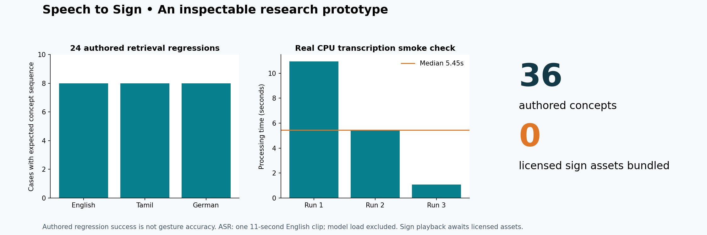
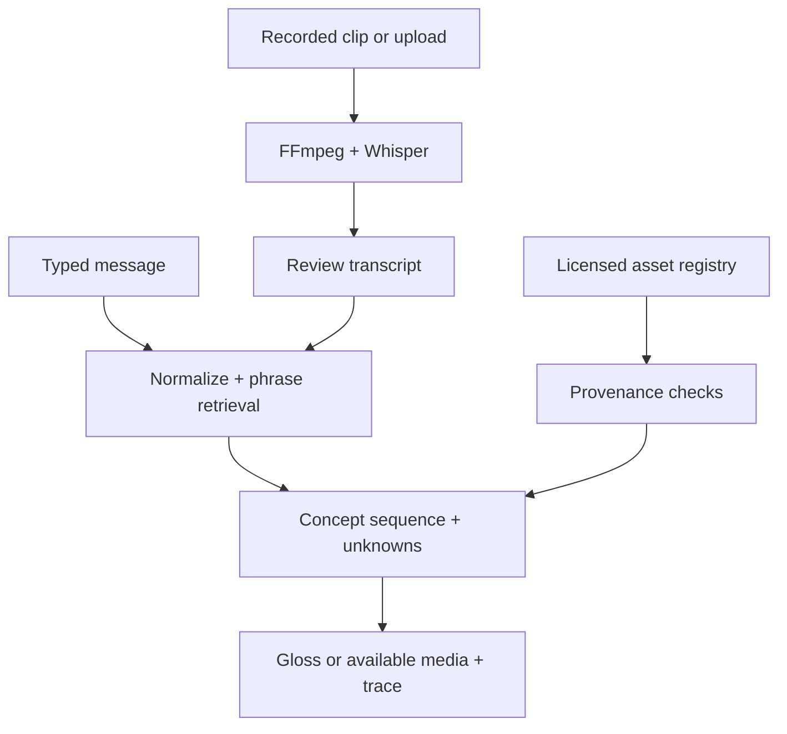

# Speech to Sign · Research Studio

### From a spoken message to an inspectable concept sequence

A runnable accessibility research prototype with **Whisper transcription**, **English / Tamil / German text input**, phrase-aware gloss retrieval and a Streamlit review interface. Every match exposes its source phrase; unknown words stay visible; licensed sign media can be registered for playback.

[Launch the studio](#launch-the-studio) · [Evaluation](docs/evaluation_methodology.md) · [Asset onboarding](docs/asset_onboarding.md) · [Claim-to-code map](docs/resume_evidence.md)



## What works today

| Component | Implementation | Evidence |
|---|---|---|
| Audio transcription | CPU `faster-whisper`, FFmpeg decoding, timestamps | [Three real transcription runs](evidence/asr_smoke.json) |
| Multilingual retrieval | Unicode normalization, longest phrase matching, explicit unknowns | [24 authored regression cases](evidence/retrieval_cases.csv) |
| Review interface | Text, recorded clip/upload, transcript review, concept cards, trace download | [Streamlit application](src/app.py) and interface regression test |
| Incremental protocol | Iterator over 16 kHz audio chunks with continuous timestamp offsets | [Pipeline](src/pipeline.py), [protocol tests](tests/test_pipeline.py) |
| Media governance | Path confinement, license/source/sign-language metadata, distinct asset hashing | [Current inventory](evidence/asset_inventory.json) |

**36 authored concepts · 117 language aliases · 0 bundled sign assets.** Aliases are not unique gestures. The current interface shows glosses until licensed media is supplied. Phrase retrieval does not implement sign-language grammar, learned context disambiguation or validated translation.

## Launch the studio

Python 3.12 and FFmpeg on PATH:

```bash
python -m venv .venv
source .venv/bin/activate
pip install -r requirements-dev.txt
streamlit run src/app.py
```

Text mode works immediately. Audio mode downloads model weights on first use, then transcribes locally. Record a short clip or upload WAV/MP3/M4A/FLAC/OGG, review the transcript, and choose it for retrieval. The interface processes completed clips; it is not a continuously streaming microphone connection.

## Reproduce the checks

```bash
python -m pytest -q
python scripts/evaluate.py --output evidence/reproduced
python scripts/validate_assets.py
# This correctly fails while the required collection is absent:
python scripts/validate_assets.py --require-assets 5000
```

For a real transcription check:

```bash
python scripts/benchmark_asr.py /path/to/audio.wav --language en --model tiny --runs 3 --output evidence/reproduced/asr_smoke.json
```

The committed smoke check used the [faster-whisper JFK test clip](https://github.com/SYSTRAN/faster-whisper/blob/master/tests/data/jfk.flac), with its audio SHA256 recorded. Three runs transcribed the same 11-second English clip; median decoding/inference time was **5.45 seconds** on the recorded CPU environment. This excludes model initialization, recording and sign playback and is not the claimed 2.1-second end-to-end benchmark.

## Architecture



## Evaluation, assets and original research

- [Evaluation protocol](docs/evaluation_methodology.md): denominators, fixtures and latency scope.
- [Asset onboarding](docs/asset_onboarding.md): register genuine licensed sign media; do not inflate counts with aliases or duplicate files.
- [Model card](docs/model_card.md): intended use, language limitations and remaining work.
- [Résumé evidence map](docs/resume_evidence.md): precise support and unresolved historical claims.
- [Original academic report](outputs/FINAL%20REPORT.pdf): retained unchanged. It describes English/Tamil and reports 85% mapping; the new implementation is an October 2026 extension, not retrospective proof of its evaluation.

The 24 curated cases all reproduce their expected concept sequences. That is a regression check, **not 88% independently evaluated gesture alignment**. A licensed 5,000-gesture collection, independent multilingual test set and publication reference are still needed to substantiate the remaining résumé claims.
